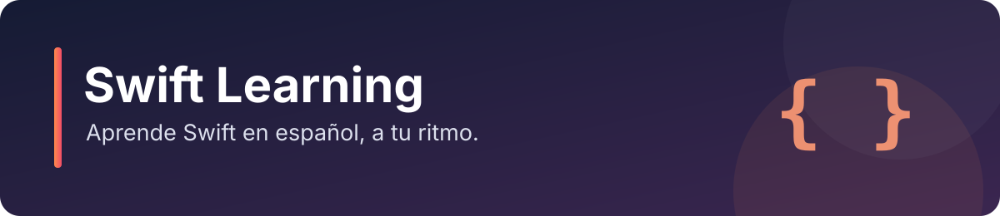

# Swift Learning

Una guía en español para aprender Swift paso a paso, consultar conceptos y practicar con ejemplos. Empieza por los fundamentos y avanza a tu ritmo hasta protocolos, concurrencia y gestión de memoria.

## Empieza aquí

1. Instala Swift siguiendo la [guía oficial](https://www.swift.org/install/). En macOS también puedes usar Xcode y sus herramientas de línea de comandos.
2. Comprueba la instalación con `swift --version`. Puedes ejecutar un archivo con `swift archivo.swift`, o probar los ejemplos en un playground de Xcode.
3. Comienza con [variables y constantes](./Guia%20de%20lenguaje/1.%20Swift%20Basico/01%20-%20Variables%20y%20Constantes%20en%20Swift.md), sigue el índice y practica con los [ejercicios](./Ejercicios/README.md).

**Ruta sugerida:** fundamentos → colecciones y control de flujo → funciones, tipos y protocolos → manejo de errores → concurrencia y memoria. Los temas avanzados se pueden consultar de forma independiente.

La guía contiene material inspirado y adaptado al español de [The Swift Programming Language](https://docs.swift.org/swift-book/) de Apple y la comunidad de Swift. Consulta la documentación oficial para conocer el comportamiento y los cambios de cada versión y la [licencia de su repositorio](https://github.com/swiftlang/swift-book/blob/main/LICENSE.txt) para el material procedente de esa fuente. Los ejemplos de consola añadidos se han comprobado con Swift 6.4; las demás lecciones pueden requerir revisión según la versión y la configuración del proyecto.

## Temario

Elige un capítulo para abrir sus lecciones. Las rutas también funcionan en una copia local o en un fork.

### 1. Swift Básico

1. [Variables y Constantes en Swift](./Guia%20de%20lenguaje/1.%20Swift%20Basico/01%20-%20Variables%20y%20Constantes%20en%20Swift.md)
2. [Anotaciones de Tipo](./Guia%20de%20lenguaje/1.%20Swift%20Basico/02%20-%20Anotaciones%20de%20tipo.md)
3. [Nomenclatura de Constantes y Variables](./Guia%20de%20lenguaje/1.%20Swift%20Basico/03%20-%20Nomenclatura%20de%20Constantes%20y%20Variables.md)
4. [Comentarios en Swift](./Guia%20de%20lenguaje/1.%20Swift%20Basico/04%20-%20Comentarios%20en%20Swift.md)
5. [Enteros](./Guia%20de%20lenguaje/1.%20Swift%20Basico/05%20-%20Enteros.md)
6. [Números de Punto Flotante](./Guia%20de%20lenguaje/1.%20Swift%20Basico/06%20-%20N%C3%BAmeros%20de%20punto%20flotante.md)
7. [Type Alias](./Guia%20de%20lenguaje/1.%20Swift%20Basico/07%20-%20Type%20Alias.md)
8. [Booleanos](./Guia%20de%20lenguaje/1.%20Swift%20Basico/08%20-%20Booleanos.md)
9. [Tuplas](./Guia%20de%20lenguaje/1.%20Swift%20Basico/09%20-%20Tuplas.md)
10. [Opcionales](./Guia%20de%20lenguaje/1.%20Swift%20Basico/10%20-%20Opcionales.md)

---

### 2. Operadores Básicos

1. [Operador de Asignación](./Guia%20de%20lenguaje/2.%20Operadores%20Basicos/01%20-%20%20Operadores%20de%20asignaci%C3%B3n.md)
2. [Operadores Aritméticos](./Guia%20de%20lenguaje/2.%20Operadores%20Basicos/02%20-%20Operadores%20aritm%C3%A9ticos.md)
3. [Operadores de Asignación Compuesta](./Guia%20de%20lenguaje/2.%20Operadores%20Basicos/03%20-%20Operadores%20de%20asignaci%C3%B3n.md)
4. [Operadores de Comparación](./Guia%20de%20lenguaje/2.%20Operadores%20Basicos/04%20-%20%20Operadores%20de%20comparaci%C3%B3n.md)
5. [Operador Condicional Ternario](./Guia%20de%20lenguaje/2.%20Operadores%20Basicos/05%20-%20%20Operador%20ternario%20condicional.md)
6. [Operador de Fusión de Nil](./Guia%20de%20lenguaje/2.%20Operadores%20Basicos/06%20-%20Operador%20coalescencia%20nula.md)
7. [Operadores de Rango](./Guia%20de%20lenguaje/2.%20Operadores%20Basicos/07%20-%20Operadores%20de%20rango.md)
8. [Operadores Lógicos](./Guia%20de%20lenguaje/2.%20Operadores%20Basicos/08%20-%20Operadores%20l%C3%B3gicos.md)

---

### 3. String y Caracteres

1. [Strings](./Guia%20de%20lenguaje/3.%20String%20y%20Carcateres/1%20-%20String.md)
2. [Trabajando con Caracteres](./Guia%20de%20lenguaje/3.%20String%20y%20Carcateres/2%20-%20Trabajando%20con%20caracteres.md)
3. [Modificación de Caracteres](./Guia%20de%20lenguaje/3.%20String%20y%20Carcateres/3%20-%20Modificando%20caracteres.md)
4. [Subcadenas](./Guia%20de%20lenguaje/3.%20String%20y%20Carcateres/4%20-%20Subcadenas.md)
5. [Unicode en Strings](./Guia%20de%20lenguaje/3.%20String%20y%20Carcateres/5%20-%20Unicode%20en%20cadenas.md)

---

### 4. Tipo de Colecciones

1. [Colecciones Mutables](./Guia%20de%20lenguaje/4.%20Tipo%20de%20Colecciones/1%20-%20Colecciones%20mutables.md)
2. [Arrays](./Guia%20de%20lenguaje/4.%20Tipo%20de%20Colecciones/2%20-%20Arrays.md)
3. [Sets](./Guia%20de%20lenguaje/4.%20Tipo%20de%20Colecciones/3%20-%20Sets.md)
4. [Diccionarios](./Guia%20de%20lenguaje/4.%20Tipo%20de%20Colecciones/4%20-%20Diccionarios.md)

---

### 5. Flujos de Control

1. [Bucles For](./Guia%20de%20lenguaje/5.%20Flujos%20de%20control/1%20-%20Bucles%20For.md)
2. [Bucles While](./Guia%20de%20lenguaje/5.%20Flujos%20de%20control/2%20-%20Bucles%20While.md)
3. [Sentencias If](./Guia%20de%20lenguaje/5.%20Flujos%20de%20control/3%20-%20%20Sentencias%20If.md)
4. [Tuplas](./Guia%20de%20lenguaje/5.%20Flujos%20de%20control/4%20-%20Tuplas.md)
5. [Where](./Guia%20de%20lenguaje/5.%20Flujos%20de%20control/5%20-%20Where.md)
6. [Control de Transferencias](./Guia%20de%20lenguaje/5.%20Flujos%20de%20control/6%20-%20Control%20de%20transferencias.md)

---

### 6. Funciones

1. [Funciones](./Guia%20de%20lenguaje/6.%20Funciones/1%20-%20Funciones.md)
2. [Parámetros y Valores de Retorno](./Guia%20de%20lenguaje/6.%20Funciones/2%20-%20Par%C3%A1metros%20y%20Valores%20de%20Retorno.md)
3. [Tuplas Opcionales](./Guia%20de%20lenguaje/6.%20Funciones/3%20-%20Tuplas%20opcionales.md)
4. [Etiquetas de Argumentos](./Guia%20de%20lenguaje/6.%20Funciones/4%20-%20Etiquetar%20argumentos.md)
5. [Parámetros Variádicos](./Guia%20de%20lenguaje/6.%20Funciones/5%20-%20Par%C3%A1metro%20variadicos.md)
6. [Parámetros In-Out](./Guia%20de%20lenguaje/6.%20Funciones/6%20-%20Par%C3%A1metros%20In-Out.md)
7. [Tipos de Función](./Guia%20de%20lenguaje/6.%20Funciones/7%20-%20Tipos%20de%20Funciones.md)
8. [Funciones como Parámetros](./Guia%20de%20lenguaje/6.%20Funciones/8%20-%20Tipos%20de%20Funci%C3%B3n%20como%20Par%C3%A1metros.md)
9. [Funciones como Retorno](./Guia%20de%20lenguaje/6.%20Funciones/9%20-%20Funci%C3%B3nes%20de%20Retorno%20.md)
10. [Funciones Anidadas](./Guia%20de%20lenguaje/6.%20Funciones/10%20-%20Funciones%20Anidadas.md)

---

### 7. Closures

1. [Qué son los Closures](./Guia%20de%20lenguaje/7.%20Clousures/1%20-%20Que%20son%20los%20Closures.md)
2. [Closures como tipos de referencia](./Guia%20de%20lenguaje/7.%20Clousures/2%20-%20Closures%20tipos%20por%20referencia.md)

---

### 8. Enum

1. [Qué son los Enums](./Guia%20de%20lenguaje/8.%20Enum/1%20-%20%20Que%20son%20los%20Enums.md)
2. [Iterar sobre los Enums](./Guia%20de%20lenguaje/8.%20Enum/2%20-%20Iterar%20sobre%20los%20Enums.md)
3. [Valores asociados en Enums](./Guia%20de%20lenguaje/8.%20Enum/3%20-%20Valores%20asociados%20Enums.md)
4. [Raw Values](./Guia%20de%20lenguaje/8.%20Enum/4%20-%20Raw%20Values.md)
5. [Valores Brutos Implícitos](./Guia%20de%20lenguaje/8.%20Enum/5%20-%20Valores%20Brutos%20implicito..md)
6. [Inicializar desde un valor en bruto](./Guia%20de%20lenguaje/8.%20Enum/6%20-%20Inicializar%20un%20valor%20en%20bruto.md)
7. [Recursividad en los Enums](./Guia%20de%20lenguaje/8.%20Enum/7%20-%20Recursividad%20en%20los%20enums.md)

---

### 9. Struct y Class
1. [Comparación entre Struct y Class](./Guia%20de%20lenguaje/9.%20struct%20y%20class/1%20-%20%20Comparacion%20struct%20%26%20class.md)
2. [Definir la Sintaxis](./Guia%20de%20lenguaje/9.%20struct%20y%20class/2%20-%20Definir%20la%20sintaxis.md)
3. [Instancias en Struct y Class](./Guia%20de%20lenguaje/9.%20struct%20y%20class/3%20-%20Instancias%20de%20struct%20y%20class.md)
4. [Accediendo a Propiedades](./Guia%20de%20lenguaje/9.%20struct%20y%20class/4%20-%20accediendo%20a%20propiedades.md)
5. [Inicialización (`init`)](./Guia%20de%20lenguaje/9.%20struct%20y%20class/5%20-%20Init.md)
6. [Struct y Enum como tipos de valor](./Guia%20de%20lenguaje/9.%20struct%20y%20class/6%20-%20struct%20y%20enum%20por%20valor.md)
7. [Clases como tipos de referencia](./Guia%20de%20lenguaje/9.%20struct%20y%20class/7%20-%20Clases%20por%20referencia.md)

---

### 10. Propiedades
1. [Stored Properties](./Guia%20de%20lenguaje/10.%20Properties/1%20-%20Stored%20Properties.md)
2. [Propiedades en constantes](./Guia%20de%20lenguaje/10.%20Properties/2%20-%20Propiedades%20almacenadas%20en%20constantes.md)
3. [Lazy Properties](./Guia%20de%20lenguaje/10.%20Properties/3%20-%20Lazy%20Properties.md)
4. [Propiedades en variables](./Guia%20de%20lenguaje/10.%20Properties/4%20-%20Propiedades%20almacenadas%20en%20variables.md)
5. [Computed Properties](./Guia%20de%20lenguaje/10.%20Properties/5%20-%20Cmputed%20Properties.md)
6. [Declaración simplificada de Getter](./Guia%20de%20lenguaje/10.%20Properties/6%20-%20Declaracion%20getter.md)
7. [Computed Properties (Read-Only)](./Guia%20de%20lenguaje/10.%20Properties/7%20-%20Computed%20Properties%28Read%20only%29.md)
8. [Observadores de Propiedades (`willSet` y `didSet`)](./Guia%20de%20lenguaje/10.%20Properties/8%20-%20willSet%20y%20didSet.md)
9. [Property Wrappers](./Guia%20de%20lenguaje/10.%20Properties/9%20-%20Propertiy%20Wrappers.md)
10. [Valores iniciales en Property Wrappers](./Guia%20de%20lenguaje/10.%20Properties/10%20-%20Valores%20iniciales.md)
11. [Property Wrappers con valores proyectados](./Guia%20de%20lenguaje/10.%20Properties/11%20-%20Properties%20Wrapper%20con%20valores.md)
12. [Variables globales y locales](./Guia%20de%20lenguaje/10.%20Properties/12%20-%20Variables%20globales%20y%20locales.md)
13. [Type Properties](./Guia%20de%20lenguaje/10.%20Properties/13%20-%20Type%20Properties.md)
14. [Type Property Syntax](./Guia%20de%20lenguaje/10.%20Properties/14%20-%20Type%20Property%20Syntax.md)
15. [Consultar y Modificar Propiedades de Tipo](./Guia%20de%20lenguaje/10.%20Properties/15%20-%20Sintaxis%20de%20Properties.md)

---

### 11. Métodos
1. [Definiendo Métodos](./Guia%20de%20lenguaje/11.%20Metodos/1%20-%20Define%20metodos.md)
2. [Método `self`](./Guia%20de%20lenguaje/11.%20Metodos/2%20-%20Metodo%20%60self%60.md)
3. [Métodos de Instancia](./Guia%20de%20lenguaje/11.%20Metodos/3%20-%20M%C3%A9todos%20de%20instancia.md)
4. [Métodos Mutating](./Guia%20de%20lenguaje/11.%20Metodos/4%20-%20mutating.md)

---

### 12. Subscripts
1. [Sintaxis](./Guia%20de%20lenguaje/12.%20Subscripts/1%20-%20Sintaxis.md)
2. [Opciones de Subíndices](./Guia%20de%20lenguaje/12.%20Subscripts/2%20-%20Opciones%20de%20sub%C3%ADndices.md)
3. [Tipos de Subíndices](./Guia%20de%20lenguaje/12.%20Subscripts/3%20-%20Tipo%20de%20sub%C3%ADndices.md)

---

### 13. Herencia
1. [Definiendo una Clase](./Guia%20de%20lenguaje/13.%20Herencia/1%20-%20Definiendo%20una%20clase.md)
2. [Subclases](./Guia%20de%20lenguaje/13.%20Herencia/2%20-%20Subclases.md)
3. [Sobrescritura](./Guia%20de%20lenguaje/13.%20Herencia/3%20-%20Overrifing.md)
4. [Sobrescribiendo Propiedades](./Guia%20de%20lenguaje/13.%20Herencia/4%20-%20Overriding%20Properties.md)
5. [Previniendo Sobrescritura](./Guia%20de%20lenguaje/13.%20Herencia/5%20-%20Previniendo%20sobreescritura.md)

---

### 14. Inicializadores
1. [Inicialización en Swift](./Guia%20de%20lenguaje/14.%20Inicializadores/1%20-%20init.md)
2. [Creando un Inicializador](./Guia%20de%20lenguaje/14.%20Inicializadores/2%20-%20Creando%20init.md)
3. [Propiedades Opcionales](./Guia%20de%20lenguaje/14.%20Inicializadores/3%20-%20Propiedades%20opcionales.md)
4. [Inicializador Predeterminado](./Guia%20de%20lenguaje/14.%20Inicializadores/4%20-%20Init%20default.md)
5. [Delegación de Inicialización en Tipos de Valor](./Guia%20de%20lenguaje/14.%20Inicializadores/5%20-%20Delegate%20values.md)
6. [Herencia en Inicialización](./Guia%20de%20lenguaje/14.%20Inicializadores/6%20-%20Herencia%20en%20init.md)
7. [Delegación de Inicialización en Clases](./Guia%20de%20lenguaje/14.%20Inicializadores/7%20-%20Delegando%20init.md)
8. [Inicializadores Fallables](./Guia%20de%20lenguaje/14.%20Inicializadores/8%20-%20init%20Failable.md)
9. [Propagación de Fallos en la Inicialización](./Guia%20de%20lenguaje/14.%20Inicializadores/9%20-%20Prropagaci%C3%B3n%20de%20init.md)
10. [Inicializadores Requeridos](./Guia%20de%20lenguaje/14.%20Inicializadores/10%20-%20Rquired%20init.md)

---

### 15. Desinicialización

1. [Desinicialización](./Guia%20de%20lenguaje/15.%20Desinicializaci%C3%B3n/1%20-%20Desinicializaci%C3%B3n.md)
2. [Desinicializadores en Acción](./Guia%20de%20lenguaje/15.%20Desinicializaci%C3%B3n/2%20-%20Desinicializadores%20en%20Acci%C3%B3n.md)

---

### 16. Optional Chaining

1. [Encadenamiento Opcional](./Guia%20de%20lenguaje/16.%20Optional%20Chaining/1%20-%20Encadenamiento%20Opcional.md)
2. [Clases de Modelo](./Guia%20de%20lenguaje/16.%20Optional%20Chaining/2%20-%20Clases%20de%20Modelo.md)
3. [Propiedades con Encadenamiento Opcional](./Guia%20de%20lenguaje/16.%20Optional%20Chaining/3%20-%20Propiedades%20Mediante%20Encadenamiento%20Opcional.md)
4. [Métodos con Encadenamiento Opcional](./Guia%20de%20lenguaje/16.%20Optional%20Chaining/4%20-%20Methods%20Optional%20Chaining.md)
5. [Subscripts con Encadenamiento Opcional](./Guia%20de%20lenguaje/16.%20Optional%20Chaining/5%20-%20Subscripts%20Optional%20Chaining.md)
7. [Multiple Levels Optional Chaining](./Guia%20de%20lenguaje/16.%20Optional%20Chaining/7%20-%20Multiple%20Levels%20Optional%20Chaining.md)
8. [Optional Return Methods](./Guia%20de%20lenguaje/16.%20Optional%20Chaining/8%20-%20Optional%20Return%20Methods.md)

---

### 17. Manejo de Errores

1. [Lanzamiento de Errores (Throwing Errors)](./Guia%20de%20lenguaje/17.%20Manejo%20de%20errores/1%20-%20Throwing%20Errors.md)
2. [Propagación de Errores](./Guia%20de%20lenguaje/17.%20Manejo%20de%20errores/2%20-%20Error%20Propagation.md)
3. [Manejo de Errores con Do-Catch](./Guia%20de%20lenguaje/17.%20Manejo%20de%20errores/3%20-%20Handling%20Errors%20Do%20Catch.md)
4. [Convertir Errores en Valores Opcionales](./Guia%20de%20lenguaje/17.%20Manejo%20de%20errores/4%20-%20Converting%20Errors%20Optional.md)
5. [Deshabilitar la Propagación de Errores](./Guia%20de%20lenguaje/17.%20Manejo%20de%20errores/5%20-%20Disabling%20Error.md)
6. [Especificar Tipos de Error](./Guia%20de%20lenguaje/17.%20Manejo%20de%20errores/6%20-%20Specifying%20Error%20Type.md)
7. [Especificar Acciones de Limpieza](./Guia%20de%20lenguaje/17.%20Manejo%20de%20errores/7%20-%20Specifying%20Cleanup%20Actions.md)

---

### 18. Concurrencia

1. [Introducción a la Concurrencia](./Guia%20de%20lenguaje/18.%20Concurrency/1%20-%20Concurrencia.md)
2. [Definir y Llamar Funciones Asíncronas](./Guia%20de%20lenguaje/18.%20Concurrency/2%20-%20Definir%20y%20Llamar%20Funciones%20As%C3%ADncronas.md)
3. [Secuencias Asíncronas](./Guia%20de%20lenguaje/18.%20Concurrency/3%20-%20Secuencias%20As%C3%ADncronas.md)
4. [Llamadas Asíncronas en Paralelo](./Guia%20de%20lenguaje/18.%20Concurrency/4%20-%20As%C3%ADncronas%20en%20paralelo.md)
5. [Tareas y Grupos de Tareas](./Guia%20de%20lenguaje/18.%20Concurrency/5%20-%20Tareas%20y%20Grupos%20de%20Tareas.md)
6. [Cancelación de Tareas](./Guia%20de%20lenguaje/18.%20Concurrency/6%20-%20Cancelaci%C3%B3n%20de%20Tareas.md)
7. [Concurrencia No Estructurada](./Guia%20de%20lenguaje/18.%20Concurrency/7%20-%20Concurrencia%20No%20Estructurada.md)
8. [Actores](./Guia%20de%20lenguaje/18.%20Concurrency/8%20-%20Actors.md)
9. [Tipos Sendable](./Guia%20de%20lenguaje/18.%20Concurrency/9%20-%20Sendable.md)
10. [Aislamiento y concurrencia en Swift 6](./Guia%20de%20lenguaje/18.%20Concurrency/10%20-%20Swift%206.md)

---

### 19. Macros

1. [¿Qué son las Macros?](./Guia%20de%20lenguaje/19.%20Macros/1%20-%20Que%20son%20las%20Macros.md)
2. [Macros Independientes](./Guia%20de%20lenguaje/19.%20Macros/2%20-%20Macros%20independientes.md)
3. [Macros Adjuntas](./Guia%20de%20lenguaje/19.%20Macros/3%20-%20Macros%20adjuntas.md)
4. [Declaraciones de Macros](./Guia%20de%20lenguaje/19.%20Macros/4%20-%20Declaraciones%20de%20Macros.md)
5. [Expansión de Macros](./Guia%20de%20lenguaje/19.%20Macros/5%20-%20Expansi%C3%B3n%20de%20Macros.md)
6. [Implementación de Macro](./Guia%20de%20lenguaje/19.%20Macros/6%20-%20Implementaci%C3%B3n%20de%20Macro.md)
7. [Desarrollo de Macros](./Guia%20de%20lenguaje/19.%20Macros/7%20-%20Desarrollo%20y%20Depuraci%C3%B3n%20de%20Macros.md)

---

### 20. Type Casting

1. [Definir una Jerarquía](./Guia%20de%20lenguaje/20.%20Type%20Casting/1%20-%20Definir%20una%20Jerarqu%C3%ADa.md)
2. [Comprobación de Tipo](./Guia%20de%20lenguaje/20.%20Type%20Casting/2%20-%20Comprobaci%C3%B3n%20de%20tipo.md)
3. [Downcasting](./Guia%20de%20lenguaje/20.%20Type%20Casting/3%20-%20Downcasting.md)
4. [Type Casting](./Guia%20de%20lenguaje/20.%20Type%20Casting/4%20-%20Type%20Casting.md)

---

### 21. Tipos Anidados

1. [Uso de Anidados](./Guia%20de%20lenguaje/21.%20Tipos%20anidados/1%20-%20Uso%20de%20anidados.md)
2. [Accediendo a Tipos Anidados](./Guia%20de%20lenguaje/21.%20Tipos%20anidados/2%20-%20Accediendo%20a%20tipos%20anidados.md)

---

### 22. Extensiones

1. [Sintaxis de Extensiones](./Guia%20de%20lenguaje/22.%20Extensiones/1%20-%20Sintaxis%20de%20Extensiones.md)
2. [Computed Properties](./Guia%20de%20lenguaje/22.%20Extensiones/2%20-%20Computed%20Properties.md)
3. [Inicializadores](./Guia%20de%20lenguaje/22.%20Extensiones/3%20-%20Initializers.md)
4. [Methods](./Guia%20de%20lenguaje/22.%20Extensiones/4%20-%20Methods.md)
5. [Mutating Instance](./Guia%20de%20lenguaje/22.%20Extensiones/5%20-%20Mutating%20instance.md)
6. [Subscripts](./Guia%20de%20lenguaje/22.%20Extensiones/6%20-%20Subscripts.md)
7. [Nested Type](./Guia%20de%20lenguaje/22.%20Extensiones/7%20-%20Nested%20Type.md)

---

## 23. Protocolos

1. [Sintaxis básica](./Guia%20de%20lenguaje/23.%20Protocolos/1%20-%20Sintax%C3%ADs%20b%C3%A1sica.md)
2. [Requisitos de propiedades](./Guia%20de%20lenguaje/23.%20Protocolos/2-%20Requisitos%20de%20propiedades.md)
3. [Requisitos de métodos](./Guia%20de%20lenguaje/23.%20Protocolos/3-%20Requisitos%20de%20m%C3%A9todos.md)
4. [Requisitos de inicializadores](./Guia%20de%20lenguaje/23.%20Protocolos/4%20-%20Requisitos%20de%20inicializadores.md)
5. [Protocolos de tipo](./Guia%20de%20lenguaje/23.%20Protocolos/5%20-%20Protocolos%20de%20tipo.md)
6. [Delegation](./Guia%20de%20lenguaje/23.%20Protocolos/6%20-%20Delegation.md)
7. [Agregar conformidad a un protocolo](./Guia%20de%20lenguaje/23.%20Protocolos/7%20-%20Agregar%20conformidad%20a%20un%20protocolo.md)
8. [Conformidad condicional](./Guia%20de%20lenguaje/23.%20Protocolos/8%20-%20Conformidad%20condicional.md)
9. [Adoptar un protocolo con implementación sintetizada](./Guia%20de%20lenguaje/23.%20Protocolos/9%20-%20Adoptar%20un%20protocolo.md)
10. [Colecciones de Tipos](./Guia%20de%20lenguaje/23.%20Protocolos/10%20-%20Colecciones%20de%20Tipos.md)
11. [Herencia de protocolo](./Guia%20de%20lenguaje/23.%20Protocolos/11%20-%20Herencia%20de%20protocolo.md)
12. [Protocolos exclusivos para clases](./Guia%20de%20lenguaje/23.%20Protocolos/12%20-%20Protocolos%20exclusivos.md)
13. [Composición de protocolos](./Guia%20de%20lenguaje/23.%20Protocolos/13%20-%20Composicion%20de%20protocolos.md)
14. [Verificación de conformidad con un protocolo](./Guia%20de%20lenguaje/23.%20Protocolos/14%20-%20Verificacion%20de%20conformidad.md)
15. [Requisitos opcionales en protocolos](./Guia%20de%20lenguaje/23.%20Protocolos/15%20-%20Requisitos%20de%20opcionales%20en%20protocolos.md)
16. [Extensiones de protocolos](./Guia%20de%20lenguaje/23.%20Protocolos/16%20-%20Extensiones%20de%20protocolos.md)
17. [Proporcionar implementaciones por defecto](./Guia%20de%20lenguaje/23.%20Protocolos/17%20-%20Proporcinoar%20implementaciones%20por%20defecto.md)
18. [Agregar restricciones a extensiones de protocolos](./Guia%20de%20lenguaje/23.%20Protocolos/18%20-%20Agregar%20restricciones%20a%20extensiones.md)

---

### 24. Genéricos

1. [Código Reutilizable sin Genéricos](./Guia%20de%20lenguaje/24.%20Genericos/1%20-%20%20C%C3%B3digo%20Repetitivo%20sin%20Gen%C3%A9ricos.md)
2. [Funciones Genéricas](./Guia%20de%20lenguaje/24.%20Genericos/2%20-%20Funciones%20gen%C3%A9ricas.md)
3. [Parámetros de Tipo](./Guia%20de%20lenguaje/24.%20Genericos/3%20-%20Parametros%20de%20Tipo.md)
4. [Nombrando Parámetros de Tipo](./Guia%20de%20lenguaje/24.%20Genericos/4%20-%20Nombrando%20Par%C3%A1metros%20de%20Tipo.md)
5. [Tipos Genéricos](./Guia%20de%20lenguaje/24.%20Genericos/5%20-%20Tipos%20Gen%C3%A9ricos.md)
6. [Extender un Tipo Genérico](./Guia%20de%20lenguaje/24.%20Genericos/6%20-%20Extender%20un%20Tipo%20Gen%C3%A9rico.md)
7. [Restricciones de Tipo](./Guia%20de%20lenguaje/24.%20Genericos/7%20-%20Restricciones%20de%20Tipo.md)
8. [Sintaxis de Restricciones de Tipo](./Guia%20de%20lenguaje/24.%20Genericos/8%20-%20Sintaxis%20de%20Restricciones%20de%20Tipo.md)
9. [Tipos Asociados](./Guia%20de%20lenguaje/24.%20Genericos/9%20-%20Tipos%20Asociados.md)
10. [Uso de Tipos Asociados](./Guia%20de%20lenguaje/24.%20Genericos/10%20-%20Uso%20de%20un%20Protocolo%20en%20las%20Restricciones%20de%20Tipos%20Asociados.md)
11. [Cláusulas `where` en Genéricos](./Guia%20de%20lenguaje/24.%20Genericos/11%20-%20Cl%C3%A1usulas%20where%20en%20Gen%C3%A9ricos.md)
12. [Cláusulas Contextuales](./Guia%20de%20lenguaje/24.%20Genericos/12%20-%20Cl%C3%A1usulas%20where%20Contextuales.md)
13. [Tipos Asociados con Cláusula `where`](./Guia%20de%20lenguaje/24.%20Genericos/13%20-%20Tipos%20Asociados%20con%20una%20Cl%C3%A1usula%20where.md)
14. [Subíndices Genéricos](./Guia%20de%20lenguaje/24.%20Genericos/14%20-%20Sub%C3%ADndices%20Gen%C3%A9ricos.md)

---

## 25. Tipos de Protocolo Opaco

1. [El Problema de los Tipos Opacos](./Guia%20de%20lenguaje/25.%20Tipos%20de%20protocolo%20opaco/1%20-%20El%20Problema%20que%20Resuelven%20los%20Tipos%20Opacos.md)
2. [Devolviendo un Tipo Opaco](./Guia%20de%20lenguaje/25.%20Tipos%20de%20protocolo%20opaco/2%20-%20Devolviendo%20un%20Tipo%20Opaco.md)
3. [Tipos de Protocolo Encapsulados](./Guia%20de%20lenguaje/25.%20Tipos%20de%20protocolo%20opaco/3%20-%20Tipos%20de%20Protocolo%20Encapsulados.md)
4. [Diferencias entre Tipos Opacos y Encapsulados](./Guia%20de%20lenguaje/25.%20Tipos%20de%20protocolo%20opaco/4%20-%20Diferencias%20entre%20Tipos%20Opacos%20y%20Tipos%20de%20Protocolo%20Encapsulados.md)

---

### 26. Recuento Automático de Referencias (ARC)

1. [Cómo Funciona ARC](./Guia%20de%20lenguaje/26.%20Recuento%20autom%C3%A1tico%20de%20referencias/1-%20C%C3%B3mo%20Funciona%20ARC.md)
2. [ARC en Acción](./Guia%20de%20lenguaje/26.%20Recuento%20autom%C3%A1tico%20de%20referencias/2%20-%20ARC%20en%20Acci%C3%B3n.md)
3. [Ciclos de Referencias Fuertes Entre Instancias de Clase](./Guia%20de%20lenguaje/26.%20Recuento%20autom%C3%A1tico%20de%20referencias/3%20-%20Ciclos%20de%20Referencia%20Fuerte%20entre%20Instancias%20de%20Clase.md)
4. [Resolviendo Ciclos de Referencias Fuertes](./Guia%20de%20lenguaje/26.%20Recuento%20autom%C3%A1tico%20de%20referencias/4%20-%20Resolviendo%20Ciclos%20de%20Referencia%20Fuerte%20entre%20Instancias%20de%20Clase.md)
5. [Referencias `unowned`](./Guia%20de%20lenguaje/26.%20Recuento%20autom%C3%A1tico%20de%20referencias/5%20-%20Referencias%20unowned.md)
6. [Referencias `unowned` Opcionales](./Guia%20de%20lenguaje/26.%20Recuento%20autom%C3%A1tico%20de%20referencias/6%20-%20Referencias%20unowned%20Opcionales.md)
7. [Ciclos de Referencias Fuertes en Closures](./Guia%20de%20lenguaje/26.%20Recuento%20autom%C3%A1tico%20de%20referencias/7%20-%20Ciclos%20de%20Referencia%20Fuerte%20con%20Closures%20.md)
8. [Resolviendo Ciclos de Referencias Fuertes en Closures](./Guia%20de%20lenguaje/26.%20Recuento%20autom%C3%A1tico%20de%20referencias/8%20-%20Resolviendo%20Ciclos%20de%20Referencia%20Fuerte%20con%20Closures.md)

---

### 27. Seguridad de la Memoria

1. [Entendiendo el Acceso a la Memoria](./Guia%20de%20lenguaje/27.%20Seguridad%20de%20la%20memoria/1%20-%20Entendiendo%20el%20Acceso%20en%20Conflicto%20a%20la%20Memoria.md)
2. [Características del Acceso a la Memoria](./Guia%20de%20lenguaje/27.%20Seguridad%20de%20la%20memoria/2%20-%20Caracter%C3%ADsticas%20del%20Acceso%20a%20la%20Memoria.md)
3. [Acceso en Parámetros inout](./Guia%20de%20lenguaje/27.%20Seguridad%20de%20la%20memoria/3%20-%20Acceso%20en%20Conflicto%20a%20Par%C3%A1metros%20inout.md)
4. [Acceso en self dentro de Métodos](./Guia%20de%20lenguaje/27.%20Seguridad%20de%20la%20memoria/4%20-%20Acceso%20en%20Conflicto%20a%20self%20en%20M%C3%A9todos.md)
5. [Acceso a Propiedades](./Guia%20de%20lenguaje/27.%20Seguridad%20de%20la%20memoria/5%20-%20Acceso%20en%20Conflicto%20a%20Propiedades.md)

---

### 28. Access Control

1. [Niveles de Acceso](./Guia%20de%20lenguaje/28.%20Access%20Control/1%20-%20Niveles%20de%20Acceso.md)
2. [Principios de Acceso](./Guia%20de%20lenguaje/28.%20Access%20Control/2%20-%20Principio%20Rector%20de%20los%20Niveles%20de%20Acceso.md)
3. [Sintaxis de Control de Acceso](./Guia%20de%20lenguaje/28.%20Access%20Control/3%20-%20Sintaxis%20del%20Control%20de%20Acceso.md)
4. [Control de Acceso en Tipos Personalizados](./Guia%20de%20lenguaje/28.%20Access%20Control/4%20-%20Control%20de%20Acceso%20en%20Tipos%20Personalizados.md)
5. [Control de Acceso en Tipos Tupla](./Guia%20de%20lenguaje/28.%20Access%20Control/5%20-%20Control%20de%20Acceso%20en%20Tipos%20Tupla.md)
6. [Control de Acceso en Tipos Anidados](./Guia%20de%20lenguaje/28.%20Access%20Control/6%20-%20Control%20de%20Acceso%20en%20Tipos%20Anidados.md)
7. [Control de Acceso en Constantes, Variables y Propiedades](./Guia%20de%20lenguaje/28.%20Access%20Control/7%20-%20Constantes%2C%20Variables%2C%20Propiedades%20y%20Sub%C3%ADndices%20con%20Control%20de%20Acceso.md)
8. [Control de Acceso en Protocolos](./Guia%20de%20lenguaje/28.%20Access%20Control/8%20-Control%20de%20Acceso%20en%20Protocolos.md)
9. [Control de Acceso en Herencia de Protocolos](./Guia%20de%20lenguaje/28.%20Access%20Control/9%20-%20Control%20de%20Acceso%20en%20la%20Herencia%20de%20Protocolos.md)
10. [Control de Acceso en Implementación de Protocolos](./Guia%20de%20lenguaje/28.%20Access%20Control/10%20-%20Control%20de%20Acceso%20en%20la%20Conformidad%20a%20Protocolos.md)
11. [Generics y Control de Acceso](./Guia%20de%20lenguaje/28.%20Access%20Control/11%20-%20Generics.md)
12. [Control de Acceso en Type Aliases](./Guia%20de%20lenguaje/28.%20Access%20Control/12%20-%20Control%20de%20Acceso%20en%20Type%20Aliases.md)

---

### 29. Advanced Operators

1. [Bitwise Operator](./Guia%20de%20lenguaje/29.%20Advanced%20Operators/1%20-%20Bitwise%20Operator.md)
2. [Bitwise AND Operator](./Guia%20de%20lenguaje/29.%20Advanced%20Operators/2%20-%20Bitwise%20AND%20Operator.md)
3. [Bitwise OR Operator](./Guia%20de%20lenguaje/29.%20Advanced%20Operators/3%20-%20Bitwise%20OR%20Operator.md)
4. [Bitwise XOR Operator](./Guia%20de%20lenguaje/29.%20Advanced%20Operators/4%20-%20Bitwise%20XOR%20Operator.md)
5. [Overflow Operator](./Guia%20de%20lenguaje/29.%20Advanced%20Operators/5%20-%20Overflow%20Operator.md)
6. [Value Overflow](./Guia%20de%20lenguaje/29.%20Advanced%20Operators/6%20-%20Value%20Overflow.md)
7. [Precedence and Associativity](./Guia%20de%20lenguaje/29.%20Advanced%20Operators/7%20-%20Precedence%20and%20Associativity.md)
8. [Operator Methods](./Guia%20de%20lenguaje/29.%20Advanced%20Operators/8%20-%20Operator%20Methods.md)
9. [Prefix and Postfix Operators](./Guia%20de%20lenguaje/29.%20Advanced%20Operators/9%20-%20Operadores%20Prefijo%20y%20Posfijo%20.md)
10. [Compound Assignment Operators](./Guia%20de%20lenguaje/29.%20Advanced%20Operators/10%20-%20Operadores%20de%20asignaci%C3%B3n%20compuesta.md)
11. [Equivalence Operators](./Guia%20de%20lenguaje/29.%20Advanced%20Operators/11%20-%20Operadores%20de%20Equivalencia.md)
12. [Custom Operators](./Guia%20de%20lenguaje/29.%20Advanced%20Operators/12%20-%20Operadores%20Personalizados.md)
13. [Result Builders](./Guia%20de%20lenguaje/29.%20Advanced%20Operators/13%20-%20Result%20Builders.md)

---

## Recursos Adicionales

- [Documentación oficial de Swift](https://docs.swift.org/swift-book/)
- [Swift.org](https://swift.org/)

¿Has encontrado un error o una explicación que se puede mejorar? Puedes abrir una incidencia o proponer un cambio. Para comprobar los enlaces locales, ejecuta `python3 scripts/check_links.py`.

El contenido propio del repositorio se distribuye bajo la [licencia MIT](./LICENSE.md). Las fuentes y materiales de terceros conservan sus condiciones correspondientes.
